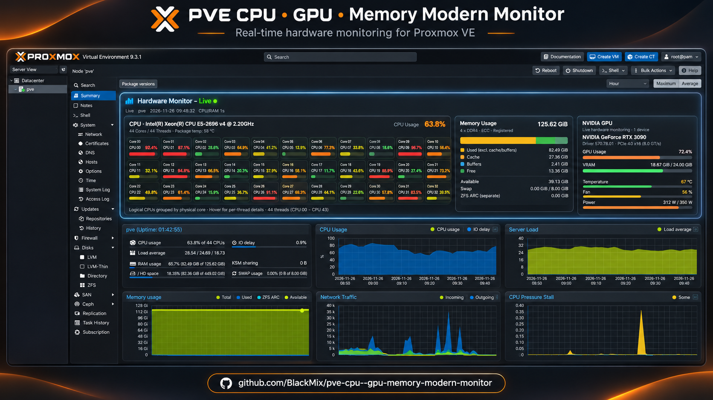
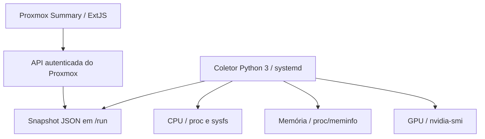

# PVE CPU • GPU • Memory Modern Monitor


[](https://github.com/BlackMix/pve-cpu--gpu-memory-modern-monitor/stargazers)

Monitoramento de hardware em tempo real, integrado diretamente à tela **Summary** do Proxmox VE. Inspirado no dashboard do Unraid, o projeto oferece uma visão detalhada da CPU, memória RAM e GPU NVIDIA, sem precisar de outro painel, Docker ou Grafana.



*Imagem promocional ilustrativa; as métricas e a topologia exibidas pelo plugin dependem do hardware real do servidor.*

> **v0.1.4:** todas as correções anteriores de integração ExtJS, altura dos painéis e numeração dos núcleos já estão incluídas. Não é necessário aplicar hotfixes separadamente.

## Recursos

### CPU — núcleos e threads em tempo real

- Utilização individual de todas as CPUs lógicas, com atualização a cada segundo.
- Agrupamento das threads por núcleo físico e socket.
- Numeração visual sequencial (`Core 00`, `Core 01`...), mantendo o identificador físico original no tooltip.
- Frequência por CPU lógica e temperatura máxima dos sensores disponíveis.
- Barras de utilização com transições suaves e cores dinâmicas independentes para cada thread.

| Cor | Utilização da thread |
| --- | --- |
| 🟢 Verde | Abaixo de 30% |
| 🟡 Amarelo | De 30% a 55%, inclusive |
| 🟠 Laranja | Acima de 55% até 90%, inclusive |
| 🔴 Vermelho | Acima de 90% |

### Memória RAM

- Memória total, utilizada, livre e disponível.
- Cache Linux, buffers e swap.
- Barra segmentada para visualizar a distribuição da memória.
- Cache ZFS ARC exibido separadamente, sem contagem dupla.

O cache Linux é calculado como `Cached + SReclaimable - Shmem`. A memória disponível é uma estimativa do kernel, não um segmento adicional da barra.

### GPU NVIDIA

- Utilização da GPU e memória VRAM.
- Temperatura, velocidade da ventoinha e consumo de energia.
- Identificação da GPU, endereço PCI e versão do driver.
- Suporte a múltiplas GPUs NVIDIA detectadas pelo `nvidia-smi`.
- Histórico local de VRAM de até 60 amostras, sem armazenamento em disco.
- Atualização aproximadamente a cada dois segundos.

### Integração com o Proxmox

- Painel responsivo e recolhível, com altura recalculada automaticamente.
- Compatibilidade visual com os temas claro e escuro.
- Gráficos e componentes originais do Summary preservados.
- API autenticada com permissão `Sys.Audit` no nó.
- Coletor leve em Python 3, gerenciado pelo systemd.
- Sem portas adicionais, telemetria externa, Docker ou compilação.

## Requisitos

- Proxmox VE 9.x (desenvolvido para a estrutura do PVE 9.3.1; outras versões precisam passar pela verificação de compatibilidade).
- Acesso `root` diretamente ao host Proxmox, não dentro de um LXC ou VM.
- Python 3, Perl, systemd e utilitários padrão do Debian.
- Driver NVIDIA funcional e `nvidia-smi` para as métricas da GPU (opcional).
- Acesso SSH ou console para recuperação, se necessário.

> [!WARNING]
> Esta é uma extensão não oficial que modifica arquivos internos do Proxmox. Execute a instalação em uma janela de manutenção, sem restaurações, backups ou migrações em andamento. O instalador pode reiniciar serviços de gerenciamento e interromper temporariamente a interface web e consoles. Não solicita reboot do host nem desligamento de VMs/LXCs.

## Instalação

### Método recomendado — baixar e verificar antes de executar

No terminal do host Proxmox:

```bash
curl -fsSL https://raw.githubusercontent.com/BlackMix/pve-cpu--gpu-memory-modern-monitor/main/install.sh -o /tmp/phm-install.sh
```

Confira a procedência e revise o instalador antes de executá-lo como root. Depois:

```bash
bash /tmp/phm-install.sh check
bash /tmp/phm-install.sh
```

### Instalação rápida via GitHub Raw

Use apenas se confiar no conteúdo publicado no repositório:

```bash
curl -fsSL https://raw.githubusercontent.com/BlackMix/pve-cpu--gpu-memory-modern-monitor/main/install.sh | bash
```

O instalador atual é autossuficiente: contém um payload compactado gerado a partir dos arquivos-fonte do projeto, com verificação de integridade. Essa verificação não autentica a origem do script. Em produção, prefira substituir `main` por uma tag ou SHA de commit revisado.

### Instalação local

Se preferir clonar o projeto (requer Git):

```bash
git clone https://github.com/BlackMix/pve-cpu--gpu-memory-modern-monitor.git
cd pve-cpu--gpu-memory-modern-monitor
bash install.sh check
bash install.sh
```

### Após instalar

Acesse o nó desejado na interface web do Proxmox e abra **Summary**. Atualize a página ignorando o cache do navegador: `Ctrl + Shift + R` no Windows/Linux ou `Command + Shift + R` no macOS.

## Atualização

O mesmo comando de instalação atualiza versões anteriores. Não é necessário desinstalar antes nem executar os fixes v0.1.2 e v0.1.3 separadamente.

```bash
curl -fsSL https://raw.githubusercontent.com/BlackMix/pve-cpu--gpu-memory-modern-monitor/main/install.sh -o /tmp/phm-install.sh
bash /tmp/phm-install.sh check
bash /tmp/phm-install.sh
```

O instalador reconhece os blocos JavaScript originais das versões 0.1.0 a 0.1.3 e da versão atual. Modificações desconhecidas são recusadas. Se a API Perl não mudou, os serviços `pvedaemon` e `pveproxy` não são reiniciados. O coletor também não é reiniciado caso seu código, unidade e estado já estejam corretos.

## Gerenciamento

Os comandos abaixo utilizam o instalador local baixado anteriormente:

| Comando | Função |
| --- | --- |
| `bash /tmp/phm-install.sh --version` | Exibir a versão do instalador |
| `bash /tmp/phm-install.sh check` | Verificar compatibilidade e segurança da instalação |
| `bash /tmp/phm-install.sh status` | Consultar estado do plugin |
| `bash /tmp/phm-install.sh repair` | Reaplicar patches após atualização compatível do PVE |
| `bash /tmp/phm-install.sh activate` | Recarregar a API mediante verificação prévia dos serviços |
| `bash /tmp/phm-install.sh uninstall` | Remover o plugin e os blocos reconhecidos |

### Reparar após atualizar o Proxmox

Atualizações do Proxmox podem sobrescrever os arquivos modificados. Não há reaplicação automática dos patches. Baixe novamente o instalador e execute:

```bash
curl -fsSL https://raw.githubusercontent.com/BlackMix/pve-cpu--gpu-memory-modern-monitor/main/install.sh -o /tmp/phm-install.sh
bash /tmp/phm-install.sh check
bash /tmp/phm-install.sh repair
```

### Desinstalar

```bash
bash /tmp/phm-install.sh uninstall
```

Ou, se já estiver utilizando o código-fonte local:

```bash
bash uninstall.sh
```

## Segurança e recuperação

Antes de reiniciar os serviços de gerenciamento do Proxmox, quando necessário, o instalador verifica tarefas PVE em execução, processos bloqueados em estado `D`, jobs do systemd e estado dos serviços. Essa verificação é conservadora e não elimina a possibilidade de uma tarefa iniciar logo depois.

Os backups ficam em `/var/backups/pve-hardware-monitor/`. Em caso de falha, o instalador tenta restaurar os arquivos modificados e o estado do coletor. Se um restart falhar, não tenta reiniciar os serviços repetidamente. Investigue a causa antes de executar `activate`.

Não restaure arquivos internos de uma versão antiga do Proxmox sobre uma versão nova.

## Diagnóstico

**Serviço coletor e logs:**

```bash
systemctl status pve-hardware-monitor --no-pager
journalctl -u pve-hardware-monitor -n 50 --no-pager
```

**Consultar métricas pela API local:**

```bash
pvesh get /nodes/$(hostname -s)/hardware-monitor --output-format json-pretty
```

O endpoint autenticado `GET /api2/json/nodes/{node}/hardware-monitor` lê o snapshot de métricas em `/run/pve-hardware-monitor/metrics.json`. O arquivo é escrito atomicamente, não contém credenciais e snapshots com mais de 15 segundos são recusados.

**Erro HTTP 501 (Method not implemented):** se o `pvesh` funcionar, mas a API HTTPS retornar 501, os serviços podem estar utilizando a versão antiga do módulo Perl. Verifique primeiro os serviços, o armazenamento e as tarefas pendentes:

```bash
systemctl status pvedaemon pveproxy --no-pager
systemctl list-jobs
```

Somente quando o host estiver saudável e sem tarefas em andamento, utilize `bash /tmp/phm-install.sh activate`. A atualização exclusivamente visual não exige reiniciar os serviços PVE.

## Arquitetura



## Estrutura do projeto

```text
.
├── assets/
│   └── image.png
├── src/
│   ├── dashboard.js
│   ├── collector.py
│   ├── endpoint.pm
│   ├── pve-hardware-monitor.service
│   └── legacy/
├── scripts/
│   └── build-installer.py
├── tests/
├── install.py
├── install.sh
├── uninstall.sh
└── README.md
```

## Desenvolvimento

O código-fonte é mantido separadamente do payload embutido em `install.sh`. Ao alterar o código, regenere o instalador antes de publicar:

```bash
python3 scripts/build-installer.py
python3 -m unittest discover -s tests -v
node --check src/dashboard.js
bash -n install.sh
```

Teste visual opcional (requer Playwright e Chromium em `/usr/bin/chromium`):

```bash
python3 tests/smoke_ui.py
```

## Compatibilidade e limitações

O projeto é experimental e não faz parte oficial do Proxmox VE. Os fixes anteriores foram utilizados em um host PVE 9.3.1; o instalador consolidado v0.1.4 ainda não teve sua compatibilidade integral confirmada nesse ambiente. Os testes locais incluem coleta Linux, idempotência, reconhecimento dos patches anteriores, reversão, limites de cores, preflight simulado e renderização em Chromium com ExtJS simulado. Não há garantia de compatibilidade com versões futuras.

Referência técnica: [proxmox/pve-manager](https://github.com/proxmox/pve-manager) (`Summary.js` e `Nodes.pm`). O projeto não depende de PVE-mods.

## Contribuições

Sugestões, correções e melhorias são bem-vindas. Ao relatar um problema, inclua a versão do Proxmox (`pveversion -v`), a versão do plugin e os logs relevantes, removendo informações sensíveis.

- [Reportar um problema ou sugerir uma melhoria](https://github.com/BlackMix/pve-cpu--gpu-memory-modern-monitor/issues)
- [Enviar um pull request](https://github.com/BlackMix/pve-cpu--gpu-memory-modern-monitor/pulls)

---

Desenvolvido por [BlackMix / Mix Dev](https://github.com/BlackMix).

Se o projeto for útil para você, considere deixar uma ⭐ no [repositório](https://github.com/BlackMix/pve-cpu--gpu-memory-modern-monitor).
