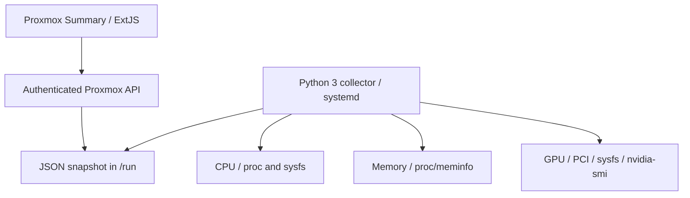

# PVE CPU • GPU • Memory Modern Monitor


[](https://github.com/BlackMix/pve-cpu--gpu-memory-modern-monitor/stargazers)

Real-time hardware monitoring integrated directly into the Proxmox VE **Summary** page. Inspired by the Unraid dashboard, this project provides detailed CPU, RAM, and NVIDIA, AMD, and Intel GPU monitoring without requiring a separate dashboard, Docker, or Grafana.


*Illustrative promotional image; the metrics and topology displayed by the plugin depend on the server's actual hardware.*

> **v0.1.7:** Automatic NVIDIA, AMD, and Intel detection, embedded SVG vendor logos, multiple GPUs, English and Brazilian Portuguese localization, equal-height responsive cards, and multicolor GPU gradients. All previous UI fixes are included. The readable installer no longer embeds a Base64 archive.

## Features

### CPU — real-time core and thread monitoring

- Individual utilization of all logical CPUs, updated every second.
- Threads grouped by physical core and socket.
- Sequential display numbering (`Core 00`, `Core 01`, etc.), with the original hardware identifier preserved in the tooltip.
- Per-logical-CPU clock frequency and the highest temperature reported by available sensors.
- Utilization bars with smooth transitions and independent dynamic colors for each thread.

| Color | Thread utilization |
| --- | --- |
| 🟢 Green | Below 30% |
| 🟡 Yellow | 30% to 55%, inclusive |
| 🟠 Orange | Above 55% up to and including 90% |
| 🔴 Red | Above 90% |

### RAM

- Total, used, free, and available memory.
- Linux cache, buffers, and swap.
- Segmented bar showing memory distribution.
- ZFS ARC cache displayed separately, without double counting.

Linux cache is calculated as `Cached + SReclaimable - Shmem`. Available memory is a kernel estimate, not an additional segment of the bar.

### GPU — NVIDIA, AMD, and Intel

- GPU utilization, VRAM, temperature, fan speed, and power consumption, when available.
- Automatic PCI detection of integrated and discrete GPUs, including mixed vendors.
- Embedded SVG vendor logos; no external icon requests.
- Passthrough devices using `vfio-pci` or `pci-stub` are detected, but host telemetry may be unavailable.
- Missing metrics display “Not supported” (or “Não suportado” in Portuguese), rather than a false zero. The GPU card is hidden if no supported vendor is detected.
- Local VRAM history of up to 60 samples, without disk storage.
- GPU sampling approximately every two seconds plus collection time; optional Intel tooling can increase the interval.
- Multicolor gradients for GPU usage, VRAM, temperature, and power; the fan bar remains blue. The VRAM chart preserves historical utilization colors.

| Color | GPU / VRAM / power scale |
| --- | --- |
| Green | Below 30% |
| Yellow | 30% to less than 55% |
| Orange | 55% to less than 90% |
| Red | 90% or more |

The temperature visualization uses a 0–85 °C reference scale, not an official thermal safety limit. Power is relative to the limit reported by the driver.

| Metric | NVIDIA | AMD | Intel |
| --- | --- | --- | --- |
| PCI detection | Yes | Yes | Yes |
| Utilization | `nvidia-smi` | `gpu_busy_percent` | `i915`: optional `intel_gpu_top` (busiest engine); `xe`: not implemented |
| VRAM / history | Driver-dependent | `mem_info_vram_*` | Not implemented in this version |
| Temperature, power, fan | Driver-dependent | `hwmon`, where available | `hwmon`, where available |

The plugin does not install GPU drivers or infer VRAM from shared system memory. AMD and Intel collection has been tested with simulated data, not physical GPUs.

### Languages

The interface follows the Proxmox language preference (`PVELangCookie` or `Proxmox.defaultLang`). Brazilian Portuguese and English are supported; other languages fall back to English. No Proxmox translation files are modified.

### Proxmox integration

- Responsive, collapsible panel with automatic height recalculation and equal-height cards within each row.
- Visual compatibility with light and dark themes.
- Preserves the original Summary charts and components.
- Authenticated API requiring the `Sys.Audit` permission on the node.
- Lightweight Python 3 collector managed by systemd.
- No additional ports, external telemetry, Docker, or compilation required.

## Requirements

- Proxmox VE 9.x (developed for the PVE 9.3.1 structure; other versions must pass the compatibility check).
- `root` access directly on the Proxmox host, not inside an LXC container or VM.
- Python 3, Perl, systemd, and standard Debian utilities.
- Optional GPU drivers and tools: NVIDIA `nvidia-smi`, AMD `amdgpu`, Intel `i915` / `xe` (optional `intel-gpu-tools` for i915 utilization), and `pciutils` for detailed PCI names.
- Git for the recommended checkout method, or curl for standalone source retrieval.
- SSH or console access for recovery, if needed.

> [!WARNING]
> This is an unofficial extension that modifies internal Proxmox files. Perform the installation during a maintenance window, with no restores, backups, or migrations in progress. The installer may restart management services and temporarily interrupt the web interface and console sessions. It does not request a host reboot or shut down VMs or LXC containers.

## Installation

### Recommended — review the source before running

Clone the repository on the Proxmox host (requires Git):

```bash
git clone https://github.com/BlackMix/pve-cpu--gpu-memory-modern-monitor.git
cd pve-cpu--gpu-memory-modern-monitor
```

Review [`install.sh`](install.sh), [`install.py`](install.py), and the [`src/`](src/) directory before executing anything as root. For reproducible deployments, check out a reviewed release tag or full commit SHA first.

```bash
bash install.sh check
bash install.sh install
```

The installer uses the local source tree and does not need network access in this mode. It does not contain an embedded archive or Base64 payload.

### Standalone launcher

The [readable install.sh](https://github.com/BlackMix/pve-cpu--gpu-memory-modern-monitor/blob/main/install.sh) can also be downloaded separately. If the source tree is not present beside the script, it retrieves a single source archive from the project's GitHub repository. Set `PHM_REF` to a reviewed tag or full commit SHA; the default is `main`. A downloaded launcher does not, by itself, verify the trustworthiness of the downloaded code. Prefer the local checkout method to review all files before running them as root.

### After installation

Select the desired node in the Proxmox web interface and open **Summary**. Perform a hard refresh to bypass the browser cache: `Ctrl + Shift + R` on Windows/Linux or `Command + Shift + R` on macOS.

## Updating

From the existing checkout, fetch and review the changes before installing (if using a pinned commit, explicitly select the new reviewed revision instead):

```bash
git pull --ff-only
bash install.sh check
bash install.sh install
```

The installer recognizes the original JavaScript blocks from versions 0.1.0 through 0.1.6 and the current version, and the previous collector when byte-identical to the known version. Unknown changes are rejected. No separate hotfixes are required. If the Perl API is unchanged, `pvedaemon` and `pveproxy` are not restarted; the collector is restarted only if necessary.

## Management

Run these commands from the reviewed project checkout:

| Command | Description |
| --- | --- |
| `bash install.sh --version` | Display the installer version |
| `bash install.sh check` | Check installation compatibility and safety |
| `bash install.sh status` | Check plugin status |
| `bash install.sh repair` | Reapply patches after a compatible PVE update |
| `bash install.sh activate` | Reload the API after checking the services |
| `bash install.sh uninstall` | Remove the plugin and recognized code blocks |

### Repair after a Proxmox update

Proxmox updates may overwrite modified files. Patches are not reapplied automatically. From a reviewed compatible checkout, run:

```bash
bash install.sh check
bash install.sh repair
```

### Uninstallation

```bash
bash install.sh uninstall
```

Or, if you are already using the local source code:

```bash
bash uninstall.sh
```

## Safety and recovery

Before restarting Proxmox management services, when necessary, the installer checks for running PVE tasks, processes blocked in the `D` state, systemd jobs, and service status. This check is conservative and does not eliminate the possibility of a task starting immediately afterward.

Backups are stored in `/var/backups/pve-hardware-monitor/`. If a failure occurs, the installer attempts to restore the modified files and collector state. If a restart fails, it does not repeatedly attempt to restart the services. Investigate the cause before running `activate`.

Do not restore internal files from an older Proxmox version over a newer version.

## Troubleshooting

**Collector service and logs:**

```bash
systemctl status pve-hardware-monitor --no-pager
journalctl -u pve-hardware-monitor -n 50 --no-pager
```

**Retrieve metrics through the local API:**

```bash
pvesh get /nodes/$(hostname -s)/hardware-monitor --output-format json-pretty
```

The authenticated `GET /api2/json/nodes/{node}/hardware-monitor` endpoint reads the metrics snapshot from `/run/pve-hardware-monitor/metrics.json`. The file is written atomically, contains no credentials, and snapshots older than 15 seconds are rejected.

**HTTP 501 error (Method not implemented):** If `pvesh` works but the HTTPS API returns 501, the services may still be using an older version of the Perl module. Check the services, storage, and pending tasks first:

```bash
systemctl status pvedaemon pveproxy --no-pager
systemctl list-jobs
```

Only run `bash install.sh activate` when the host is healthy and no tasks are in progress. UI-only updates do not require restarting PVE services.

## Architecture



## Project structure

```text
.
├── assets/
│   └── image.png
├── src/
│   ├── dashboard.js
│   ├── collector.py
│   ├── endpoint.pm
│   ├── pve-hardware-monitor.service
│   └── legacy/
├── scripts/
│   └── build-installer.py
├── tests/
├── install.py
├── install.sh
├── uninstall.sh
└── README.md
```

## Development

The installer uses the source files directly. No installer generation is necessary after changing the collector or UI. Run the following checks before publishing:

```bash
python3 -m unittest discover -s tests -v
node --check src/dashboard.js
bash -n install.sh
```

Optional visual test (requires Playwright and Chromium at `/usr/bin/chromium`):

```bash
python3 tests/smoke_ui.py
```

## Compatibility and limitations

This project is experimental and is not an official part of Proxmox VE. Previous fixes have been used on a PVE 9.3.1 host; the latest readable launcher has not yet been validated on a live Proxmox host. Local tests cover Linux metric collection, idempotency, recognition of previous patches, rollback, color thresholds, simulated preflight checks, and Chromium rendering with simulated ExtJS. Compatibility with future versions is not guaranteed.

Technical reference: [proxmox/pve-manager](https://github.com/proxmox/pve-manager) (`Summary.js` and `Nodes.pm`). The project does not depend on PVE-mods. SVG vendor logos are derived from [Simple Icons](https://github.com/simple-icons/simple-icons). Trademarks belong to their respective owners; no vendor affiliation or endorsement is implied.

## Contributing

Suggestions, fixes, and improvements are welcome. When reporting an issue, include the Proxmox version (`pveversion -v`), the plugin version, and relevant logs, with sensitive information removed.

- [Report an issue or suggest an improvement](https://github.com/BlackMix/pve-cpu--gpu-memory-modern-monitor/issues)
- [Submit a pull request](https://github.com/BlackMix/pve-cpu--gpu-memory-modern-monitor/pulls)

---

Developed by [BlackMix / Mix Dev](https://github.com/BlackMix).

If you find this project useful, consider giving the [repository](https://github.com/BlackMix/pve-cpu--gpu-memory-modern-monitor) a ⭐.
