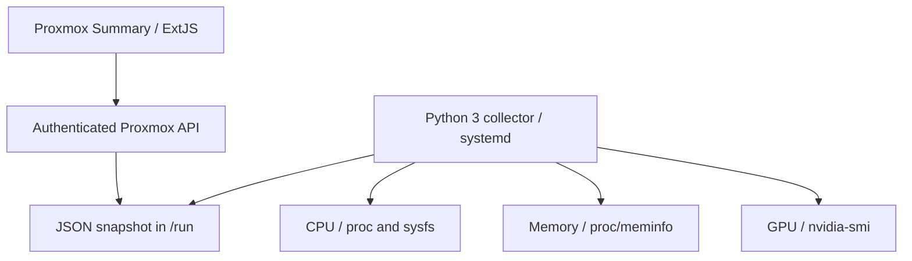

# PVE CPU • GPU • Memory Modern Monitor


[](https://github.com/BlackMix/pve-cpu--gpu-memory-modern-monitor/stargazers)

Real-time hardware monitoring integrated directly into the Proxmox VE **Summary** page. Inspired by the Unraid dashboard, this project provides detailed CPU, RAM, and NVIDIA GPU monitoring without requiring a separate dashboard, Docker, or Grafana.


*Illustrative promotional image; the metrics and topology displayed by the plugin depend on the server's actual hardware.*

> **v0.1.4:** All previous fixes for ExtJS integration, panel height, and core numbering are included. No separate hotfixes are required.

## Features

### CPU — real-time core and thread monitoring

- Individual utilization of all logical CPUs, updated every second.
- Threads grouped by physical core and socket.
- Sequential display numbering (`Core 00`, `Core 01`, etc.), with the original hardware identifier preserved in the tooltip.
- Per-logical-CPU clock frequency and the highest temperature reported by available sensors.
- Utilization bars with smooth transitions and independent dynamic colors for each thread.

| Color | Thread utilization |
| --- | --- |
| 🟢 Green | Below 30% |
| 🟡 Yellow | 30% to 55%, inclusive |
| 🟠 Orange | Above 55% up to and including 90% |
| 🔴 Red | Above 90% |

### RAM

- Total, used, free, and available memory.
- Linux cache, buffers, and swap.
- Segmented bar showing memory distribution.
- ZFS ARC cache displayed separately, without double counting.

Linux cache is calculated as `Cached + SReclaimable - Shmem`. Available memory is a kernel estimate, not an additional segment of the bar.

### NVIDIA GPU

- GPU utilization and VRAM usage.
- Temperature, fan speed, and power consumption.
- GPU identification, PCI address, and driver version.
- Support for multiple NVIDIA GPUs detected by `nvidia-smi`.
- Local VRAM history of up to 60 samples, without writing to disk.
- Updates approximately every two seconds.

### Proxmox integration

- Responsive, collapsible panel with automatic height recalculation.
- Visual compatibility with light and dark themes.
- Preserves the original Summary charts and components.
- Authenticated API requiring the `Sys.Audit` permission on the node.
- Lightweight Python 3 collector managed by systemd.
- No additional ports, external telemetry, Docker, or compilation required.

## Requirements

- Proxmox VE 9.x (developed for the PVE 9.3.1 structure; other versions must pass the compatibility check).
- `root` access directly on the Proxmox host, not inside an LXC container or VM.
- Python 3, Perl, systemd, and standard Debian utilities.
- A working NVIDIA driver and `nvidia-smi` for GPU metrics (optional).
- SSH or console access for recovery, if needed.

> [!WARNING]
> This is an unofficial extension that modifies internal Proxmox files. Perform the installation during a maintenance window, with no restores, backups, or migrations in progress. The installer may restart management services and temporarily interrupt the web interface and console sessions. It does not request a host reboot or shut down VMs or LXC containers.

## Installation

### Recommended method — download and review before running

On the Proxmox host terminal:

```bash
curl -fsSL https://raw.githubusercontent.com/BlackMix/pve-cpu--gpu-memory-modern-monitor/main/install.sh -o /tmp/phm-install.sh
```

Verify the source and review the installer before running it as root. Then:

```bash
bash /tmp/phm-install.sh check
bash /tmp/phm-install.sh
```

### Quick installation via GitHub Raw

Only use this method if you trust the content published in the repository:

```bash
curl -fsSL https://raw.githubusercontent.com/BlackMix/pve-cpu--gpu-memory-modern-monitor/main/install.sh | bash
```

The current installer is self-contained: it includes a compressed payload generated from the project's source files, with an integrity check. This check does not authenticate the script's origin. In production, prefer replacing `main` with a reviewed release tag or commit SHA.

### Local installation

If you prefer to clone the project (requires Git):

```bash
git clone https://github.com/BlackMix/pve-cpu--gpu-memory-modern-monitor.git
cd pve-cpu--gpu-memory-modern-monitor
bash install.sh check
bash install.sh
```

### After installation

Select the desired node in the Proxmox web interface and open **Summary**. Perform a hard refresh to bypass the browser cache: `Ctrl + Shift + R` on Windows/Linux or `Command + Shift + R` on macOS.

## Updating

The same installation command updates previous versions. There is no need to uninstall first or apply the v0.1.2 and v0.1.3 fixes separately.

```bash
curl -fsSL https://raw.githubusercontent.com/BlackMix/pve-cpu--gpu-memory-modern-monitor/main/install.sh -o /tmp/phm-install.sh
bash /tmp/phm-install.sh check
bash /tmp/phm-install.sh
```

The installer recognizes the original JavaScript blocks from versions 0.1.0 through 0.1.3, as well as the current version. Unrecognized modifications are rejected. If the Perl API has not changed, the `pvedaemon` and `pveproxy` services are not restarted. The collector is also not restarted if its code, service unit, and state are already correct.

## Management

The following commands use the previously downloaded local installer:

| Command | Description |
| --- | --- |
| `bash /tmp/phm-install.sh --version` | Display the installer version |
| `bash /tmp/phm-install.sh check` | Check installation compatibility and safety |
| `bash /tmp/phm-install.sh status` | Check plugin status |
| `bash /tmp/phm-install.sh repair` | Reapply patches after a compatible PVE update |
| `bash /tmp/phm-install.sh activate` | Reload the API after checking the services |
| `bash /tmp/phm-install.sh uninstall` | Remove the plugin and recognized code blocks |

### Repair after a Proxmox update

Proxmox updates may overwrite modified files. Patches are not reapplied automatically. Download the installer again and run:

```bash
curl -fsSL https://raw.githubusercontent.com/BlackMix/pve-cpu--gpu-memory-modern-monitor/main/install.sh -o /tmp/phm-install.sh
bash /tmp/phm-install.sh check
bash /tmp/phm-install.sh repair
```

### Uninstallation

```bash
bash /tmp/phm-install.sh uninstall
```

Or, if you are already using the local source code:

```bash
bash uninstall.sh
```

## Safety and recovery

Before restarting Proxmox management services, when necessary, the installer checks for running PVE tasks, processes blocked in the `D` state, systemd jobs, and service status. This check is conservative and does not eliminate the possibility of a task starting immediately afterward.

Backups are stored in `/var/backups/pve-hardware-monitor/`. If a failure occurs, the installer attempts to restore the modified files and collector state. If a restart fails, it does not repeatedly attempt to restart the services. Investigate the cause before running `activate`.

Do not restore internal files from an older Proxmox version over a newer version.

## Troubleshooting

**Collector service and logs:**

```bash
systemctl status pve-hardware-monitor --no-pager
journalctl -u pve-hardware-monitor -n 50 --no-pager
```

**Retrieve metrics through the local API:**

```bash
pvesh get /nodes/$(hostname -s)/hardware-monitor --output-format json-pretty
```

The authenticated `GET /api2/json/nodes/{node}/hardware-monitor` endpoint reads the metrics snapshot from `/run/pve-hardware-monitor/metrics.json`. The file is written atomically, contains no credentials, and snapshots older than 15 seconds are rejected.

**HTTP 501 error (Method not implemented):** If `pvesh` works but the HTTPS API returns 501, the services may still be using an older version of the Perl module. Check the services, storage, and pending tasks first:

```bash
systemctl status pvedaemon pveproxy --no-pager
systemctl list-jobs
```

Only run `bash /tmp/phm-install.sh activate` when the host is healthy and no tasks are in progress. UI-only updates do not require restarting PVE services.

## Architecture



## Project structure

```text
.
├── assets/
│   └── image.png
├── src/
│   ├── dashboard.js
│   ├── collector.py
│   ├── endpoint.pm
│   ├── pve-hardware-monitor.service
│   └── legacy/
├── scripts/
│   └── build-installer.py
├── tests/
├── install.py
├── install.sh
├── uninstall.sh
└── README.md
```

## Development

The source code is maintained separately from the embedded payload in `install.sh`. When modifying the code, regenerate the installer before publishing:

```bash
python3 scripts/build-installer.py
python3 -m unittest discover -s tests -v
node --check src/dashboard.js
bash -n install.sh
```

Optional visual test (requires Playwright and Chromium at `/usr/bin/chromium`):

```bash
python3 tests/smoke_ui.py
```

## Compatibility and limitations

This project is experimental and is not an official part of Proxmox VE. Previous fixes have been used on a PVE 9.3.1 host; the consolidated v0.1.4 installer has not yet been fully validated in that environment. Local tests cover Linux metric collection, idempotency, recognition of previous patches, rollback, color thresholds, simulated preflight checks, and Chromium rendering with simulated ExtJS. Compatibility with future versions is not guaranteed.

Technical reference: [proxmox/pve-manager](https://github.com/proxmox/pve-manager) (`Summary.js` and `Nodes.pm`). The project does not depend on PVE-mods.

## Contributing

Suggestions, fixes, and improvements are welcome. When reporting an issue, include the Proxmox version (`pveversion -v`), the plugin version, and relevant logs, with sensitive information removed.

- [Report an issue or suggest an improvement](https://github.com/BlackMix/pve-cpu--gpu-memory-modern-monitor/issues)
- [Submit a pull request](https://github.com/BlackMix/pve-cpu--gpu-memory-modern-monitor/pulls)

---

Developed by [BlackMix / Mix Dev](https://github.com/BlackMix).

If you find this project useful, consider giving the [repository](https://github.com/BlackMix/pve-cpu--gpu-memory-modern-monitor) a ⭐.
